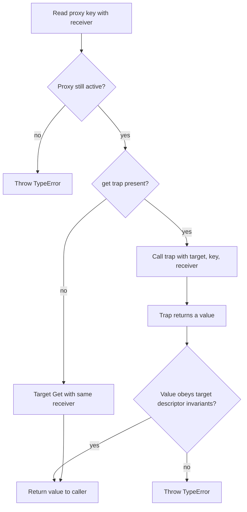
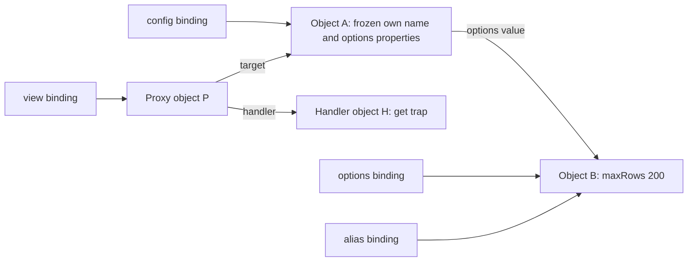

# Internal Working

## Read a Property as an Operation

The specification describes observable behavior using internal methods such as `[[Get]]`, `[[Set]]`, and `[[DefineOwnProperty]]`. Those names are not JavaScript methods you can invoke on an object. Ordinary objects implement their usual algorithms; a proxy implements versions that may call handler traps before checking invariants. The [object internal methods](https://tc39.es/ecma262/multipage/ordinary-and-exotic-objects-behaviours.html) are a semantic model, not a promise about machine instructions or a physical descriptor record in memory.

For `proxy.key`, the receiver initially is the proxy. A present `get` trap receives that receiver. An absent trap delegates directly to the target's get operation with the receiver preserved. A thrown error interrupts either path; a completed trap result must also satisfy the proxy get invariants.



Diagram source: `diagrams/volume-2-chapter-05-proxy-get-flow.mmd`.

The diagram's return arrows cover successful operations. Looking up the handler's trap, running the trap, or consulting a target that is itself a proxy can throw. Errors are propagated, and earlier user-code effects are not rolled back. The precise sequence is specified by [Proxy `[[Get]]`](https://tc39.es/ecma262/multipage/ordinary-and-exotic-objects-behaviours.html#sec-proxy-object-internal-methods-and-internal-slots-get-p-receiver).

## Execution Trace: One Accessor, Two Get Operations

```js
'use strict';

const events = [];
const target = {
  state: 'queued',
  get label() {
    events.push('getter');
    return `job:${this.state}`;
  }
};
const proxy = new Proxy(target, {
  get(object, key, receiver) {
    events.push(`get:${String(key)}`);
    return Reflect.get(object, key, receiver);
  }
});
console.log(proxy.label);
console.log(events.join(' | '));
// Expected output:
// job:queued
// get:label | getter | get:state
```

1. The caller reads `proxy.label`, invoking the proxy's get operation with `proxy` as receiver.
2. The trap records `get:label` and calls `Reflect.get` on the target with that same receiver.
3. Ordinary lookup finds the target's `label` accessor and calls its getter with `this` equal to the proxy.
4. The getter records `getter` and evaluates `this.state`.
5. Because `this` is the proxy, that read invokes the trap again, now for `state`.
6. Forwarding the second read finds an ordinary data property and returns `queued`.
7. The getter produces `job:queued`. The original trap returns that string, and the proxy's invariant check permits it.

Changing the forwarding expression to `object[key]` would run the getter with the target as `this` and remove the second trap call. That is a behavioral change, not merely a faster spelling.

## Execution Trace: Set Can Lead to Define

An ordinary data-property write uses the receiver as the place where the new own value may be installed. When the receiver is a proxy, that installation can invoke its define-property operation. The two traps represent different steps of the same assignment:

```js
'use strict';

const events = [];
const target = { count: 1 };
const proxy = new Proxy(target, {
  set(object, key, value, receiver) {
    events.push(`set:${String(key)}`);
    return Reflect.set(object, key, value, receiver);
  },
  defineProperty(object, key, descriptor) {
    events.push(`define:${String(key)}`);
    return Reflect.defineProperty(object, key, descriptor);
  }
});
proxy.count = 2;
console.log(events.join(' | '));
console.log(target.count);
events.length = 0;
Object.defineProperty(proxy, 'count', { value: 3 });
console.log(events.join(' | '));
console.log(target.count);
// Expected output:
// set:count | define:count
// 2
// define:count
// 3
```

For the assignment, `Reflect.set` first consults the target's writable data descriptor. The receiver's own-property inspection and definition then complete the write. With no custom descriptor-inspection trap, that inspection delegates to the target; the custom `defineProperty` trap remains visible. The direct definition has no initial set operation. Counting both traps as separate user writes would double-count this particular assignment.

The ordinary algorithm is [OrdinarySetWithOwnDescriptor](https://tc39.es/ecma262/multipage/ordinary-and-exotic-objects-behaviours.html#sec-ordinarysetwithowndescriptor). Returning `false` from a set trap rejects the operation; a strict assignment turns that false result into `TypeError`. Returning true without forwarding can leave target state unchanged, subject to the target's invariants. A trap result is not evidence that your persistence or validation rule ran.

## Memory Model: Frozen Root, Shared Child, Separate Proxy

```js
'use strict';

const options = { maxRows: 100 };
const config = Object.freeze({ name: 'export', options });
const alias = options;
const view = new Proxy(config, {
  get(target, key, receiver) { return Reflect.get(target, key, receiver); }
});
alias.maxRows = 200;
console.log(view === config, view.options === alias);
console.log(view.options.maxRows, Object.isFrozen(config));
// Expected output:
// false true
// 200 true
```



Diagram source: `diagrams/volume-2-chapter-05-ownership-memory.mmd`.

The arrows indicate identity relationships, not exposed memory addresses. Freezing object A restricts its own descriptors. Object B remains shared and mutable. Proxy P has its own identity and forwards to A; it does not intercept a direct write through `alias`. In this example A's `options` property is non-configurable and non-writable, so the get trap must return that exact object B. A generic wrapper cannot substitute a different proxy for B without violating that get invariant.

## What an Engine May Optimize

An engine may represent ordinary property layouts with shared metadata and specialize access sites when object shapes and descriptors are predictable. Accessors and proxies introduce observable calls that must retain their specified behavior. A proxy trap can log, throw, mutate another object, or trigger additional traps. An optimizer must preserve those effects.

It does not follow that every proxy operation has a fixed slowdown, that freezing guarantees faster reads, or that an implementation allocates one physical object for every abstract specification record. Measure the target runtime and representative workload. [V8's fast-properties explanation](https://v8.dev/blog/fast-properties) describes an implementation strategy and its historical context; it is not a cross-engine storage or complexity contract.

## A Debugging Trace to Reuse

For a surprising operation, write down the starting object identity, key, descriptor kind, receiver, invoked trap, and forwarding target. Then record whether the operation returns normally, reports false, or throws. Inspect descriptors without reading property values when dealing with ordinary accessor-bearing objects, and remember that proxy inspection itself can execute code.

Use the [edge cases](09-edge-cases-debugging.md) to test this trace against invariant violations, shallow freezing, and receiver-dependent behavior. The [production contracts](04-production-examples.md) constrain object kinds and exposed values so the behavior remains auditable.
