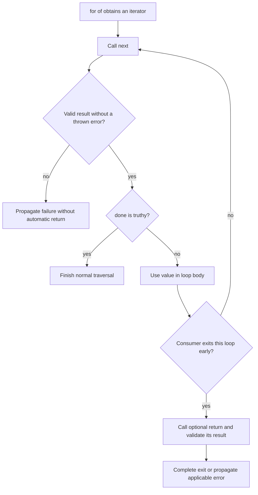
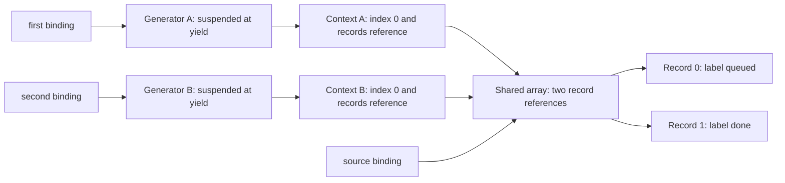

# Internal Working

## Follow the Consumer's Operations

A synchronous `for...of` loop obtains an iterator from the iterable's symbol method, obtains its next method, and repeatedly requests step objects. It checks completion before delivering a value to the body. An early exit originating in the consumer can initiate closing. A failure while obtaining or advancing the iterator follows a different path.



Diagram source: `diagrams/volume-2-chapter-06-iterator-flow.mmd`.

The diagram assumes iterator acquisition succeeded. A missing or invalid symbol method, an invalid returned iterator, and a non-callable next method can fail before the first useful step. Reading result properties can also execute getters and fail; those producer-side step failures do not imply an automatic close. A `continue` of the same loop requests another step. A control transfer that exits this loop is different. The detailed [for-in/of body evaluation](https://tc39.es/ecma262/multipage/ecmascript-language-statements-and-declarations.html#sec-runtime-semantics-forin-div-ofbodyevaluation-lhs-stmt-iterator-lhskind-labelset) specifies these branches.

## Execution Trace: An Observable Iterator

```js
'use strict';

const events = [];
const source = {
  [Symbol.iterator]() {
    events.push('iterator');
    let index = 0;
    return {
      next() {
        events.push(`next:${index}`);
        return { value: index++, done: false };
      },
      return() {
        events.push('return');
        return { done: true };
      }
    };
  }
};
for (const value of source) {
  events.push(`body:${value}`);
  if (value === 1) break;
}
console.log(events.join(' | '));
// Expected output:
// iterator | next:0 | body:0 | next:1 | body:1 | return
```

1. The symbol method runs once for this traversal and constructs a cursor with private `index` state.
2. The first next call returns an unfinished step containing zero.
3. The body observes zero and completes normally, so the loop requests another step.
4. The second step contains one; its body executes `break`.
5. The loop invokes the cursor's return method and checks that its result is an object.
6. The loop exits without requesting value two. Iterator closing does not inspect the close result's `done` flag to keep driving cleanup.

This source is intentionally unbounded. The bounded consumer is part of the example's contract; spreading the source would never complete. Notice that the returned cursor lacks its own symbol method. It can still serve as the iterator returned by a valid iterable, even though directly spreading that cursor would fail.

## Generator State Is Explicit in the Semantic Model

The specification gives generator objects states and a resumable execution context. These describe observable behavior, not a fixed layout of bytes in every engine. A useful state model is:

| State | Meaning | Consequence of a control request |
| --- | --- | --- |
| Suspended start | Body has not begun | `next()` begins it; `return()` completes without entering it; `throw()` throws without entering it |
| Suspended yield | A yield has returned control | Next, return, or throw resumes at that suspension point |
| Executing | Body is currently running | Reentrant control of the same generator throws `TypeError` |
| Completed | Body finished or escaped with an uncaught throw | Next reports completion; return reports its supplied value; throw throws its supplied error |

On a normal resume from a yield, the supplied next argument becomes the result of that yield expression. A return or throw request instead supplies a different completion, allowing existing `finally` or `catch` logic to run. Delegation may transfer that request onward. See [generator objects and resume operations](https://tc39.es/ecma262/multipage/control-abstraction-objects.html#sec-generator-objects).

```js
'use strict';

let cursor;
function* guarded() {
  try {
    cursor.next();
  } catch (error) {
    yield error.name;
  }
  return 'complete';
}
cursor = guarded();
console.log(cursor.next().value);
console.log(JSON.stringify(cursor.next()));
// Expected output:
// TypeError
// {"value":"complete","done":true}
```

The inner next call happens while the same generator is executing, so it fails. The surrounding catch handles that failure and then yields. Recursively calling a generator function would create another object; recursively resuming this same object does not.

## Memory: Independent Cursors Can Retain Shared Data

Suspension preserves the bindings and continuation needed to resume. A reference stored in those bindings can keep an input graph reachable. This does not clone that graph or make it immutable.

```js
'use strict';

function* readLabels(records) {
  for (let index = 0; index < records.length; index += 1) {
    yield records[index].label;
  }
}
const source = [{ label: 'queued' }, { label: 'waiting' }];
const first = readLabels(source);
const second = readLabels(source);
console.log(first.next().value, second.next().value);
source[1].label = 'done';
console.log(first.next().value, second.next().value);
console.log(first.next().done, second.next().done);
// Expected output:
// queued queued
// done done
// true true
```

After the first pair of reads and the mutation, both cursors are suspended at their first yield. Each still has `index` equal to zero; the loop increment runs when it resumes. Both contexts refer to the same input array:



Diagram source: `diagrams/volume-2-chapter-06-generator-memory.mmd`.

The two position bindings are independent, but both second reads observe the mutation. Yielding each label produces a primitive string; yielding each record instead would expose the mutable record itself. Copying only the outer array would still share the records. Apply the ownership rules from [Descriptors, Immutability, and Proxies](../chapter-05/01-introduction.md) when the traversal must represent a stable snapshot.

## Engine Internals Without Inventing a Stack Layout

A running generator executes synchronously on the current agent. At a suspension point the engine must retain enough state to produce the specified future behavior, including relevant locals, control position, and pending completion handling. It need not preserve an ordinary native stack frame exactly as drawn in a textbook. Implementations may lower suspension points to resumable states, optimize dead values, and represent retained environments in different ways.

The memory diagram therefore represents semantic reachability. It does not predict an allocation count or promise immediate reclamation at completion. A yielded object retained by the caller remains reachable independently of the generator, and other closures may also retain input data. Closing a resource is an explicit operation; waiting for garbage collection is not equivalent.

There is one call stack's worth of work at a time here, with control moving between caller and generator. A suspended generator is not a scheduled background task. The next caller pays for all synchronous computation performed before the next suspension. This distinction is central to both [performance analysis](10-performance-security.md) and debugging a pipeline that appears lazy but blocks on each pull.
